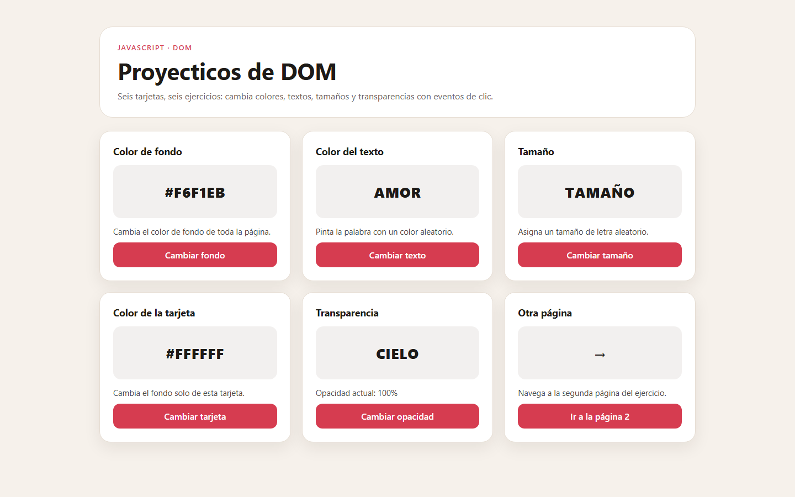

# Proyecticos de DOM

Colección de pequeños ejercicios para practicar la manipulación del DOM con JavaScript puro: eventos de clic, estilos en línea, colores aleatorios y navegación entre páginas.

**Demo:** https://alejo234506.github.io/PROYECTICOS_DE_DOM/

## Ejercicios

| # | Tarjeta | Qué hace |
| --- | --- | --- |
| 1 | Color de fondo | Genera un color hexadecimal aleatorio y lo aplica al fondo de la página. |
| 2 | Color del texto | Cambia el color de la palabra "AMOR". |
| 3 | Tamaño | Asigna un tamaño de letra aleatorio entre 16 y 48 px. |
| 4 | Color de la tarjeta | Cambia el fondo de esa tarjeta y ajusta el color del texto para que siga siendo legible. |
| 5 | Transparencia | Cambia la opacidad de "CIELO" (mínimo 10 %) y muestra el valor. |
| 6 | Otra página | Navega a `index2.html`, que tiene un botón para devolverse. |

## Cómo ejecutarlo

No necesita instalación: abre `index.html` en el navegador.

## Archivos

- `index.html`, `index.css`, `index.js`: página principal con las tarjetas.
- `index2.html`, `index2.css`, `index2.js`: segunda página.
